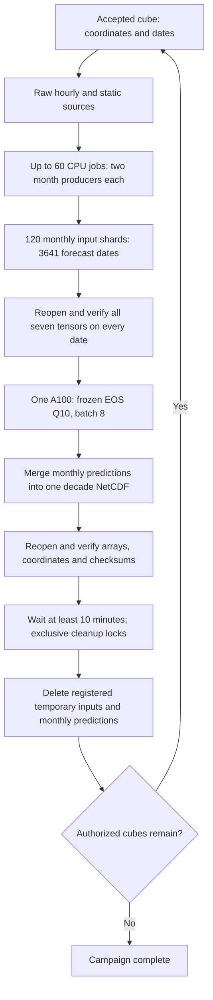

# WISP EOS: decade inference with at most 60 CPU jobs

This directory records the operational pipeline used to prepare and predict one
complete ten-year cube at a time on the Jena cluster. It is separate from the
repository's Julia site/PFT/entity SINDBAD runners. It does **not** run SINDBAD,
change its configuration, or overwrite its input cubes.

[中文流程](WORKFLOW_ZH.md) · [Detailed engine reference](engine/README_EN.md) ·
[The 16-cube campaign](campaigns/granada_plus15_20261104/manifest.csv)

## Validation status and scope

The six-job pilot passed on **4 November 2026, 19:30 CET**. All 12 producer
processes completed at least three new dates. Each producer's first new date
matched all seven input tensors from a fresh frozen full-window reference.
Aggregate process RSS for every pilot job stayed below 12 GiB. The deployment
subsequently ran 60 CPU jobs concurrently without a new blocking error at the
last inspection. This establishes scheduling and input-production feasibility,
**not** an optimal throughput claim or completed end-to-end decade validation.
The first complete decade, GPU stage and final cleanup still require their live
acceptance checks. Month completion is uneven; the slowest months determine when
prediction can start. Do not promise a 15–18-hour runtime from a percentage alone.

The engine's 56 automated checks cover locks, recovery, schema, input/prediction
state separation, product consolidation and delayed cleanup. The campaign's
additional tests cover bounded selection, immutable identities, cleanup-before-
advance and stopping after exactly the authorized cubes.

## Workflow



The campaign retains the active Granada cube `T000830`, then processes 15 already
accepted/enrolled cubes in the existing frozen tile order. It does not re-sample
the scientific population and does not claim these 15 are a new representative
sample. Exactly 16 final products, including Granada, are required before the
campaign is complete. Existing other-cube checkpoints remain parked and counted
against scratch capacity. Unselected cubes are not admitted automatically.

## Resources

| Component | Allocation / policy |
|---|---|
| CPU production | At most 60 jobs; 4 CPUs and 16 GiB per job; 24-hour wall time |
| Producer layout | Two independent processes per job, each owning one month |
| Thread limits | Two computation threads per producer; Blosc compression one thread; OpenBLAS one thread |
| CPU partitions | `work,small,gpu`; never `big`; CPU jobs request no GPU device |
| Total jobs | At most 120 queued + running, including control and cleanup |
| GPU | One A100, batch 8, only after the entire active cube's inputs validate |
| Scratch | 1 TiB reservation budget, including parked inputs and quarantine |
| Current-cube reservation | 120 × 8 GiB = 960 GiB, plus parked actual allocation and shared-cache allowance |

A job's CPU/memory allocation is not its measured utilization. Resources are
recorded in `state/job_resources/`. Shared I/O and spatial processing can dominate
elapsed time even when most allocated RAM is unused. Two workers never own the
same month; active months are not redundantly replicated across jobs.

## Frozen scientific input protocol

- Forecast dates: **2014-01-12–2023-12-31**, 3,641 days; daily UTC-midnight starts.
- Each forecast `t0` reads `[t0−96 hours, t0+24 hours)`. First weather hour:
  **2014-01-08 00:00 UTC**. Each month supplies its own history margin.
- Dates within a month are processed in order. The rolling weather window reuses
  overlapping history and reads the next 24 hours as the forecast date advances.
- Use raw source data, not a reconstruction from the daily SINDBAD cube.
- Use frozen training normalization constants from the audited provenance file
  `normalization/actual_normalization_constants.json`. No fitting or recomputation
  of dataset-wide means/std on the new cubes. Radiation retains its native-tile,
  full-120-hour min/max step; special categorical/fire/FRP conversions remain.
- Preserve both original float16 stages; store assembled tensors as losslessly
  compressed float32. Do not normalize them a second time on loading.
- Use real observed fire history, including the previously approved NOAA-20
  outage replacement. There is no prediction feedback. Future fire, FRP and
  vegetation do not enter model input. Weather in the following 24 hours is
  retrospective ERA5, not an operational forecast.
- Model: **EOS corrected / Q10 / seed42 / epoch46**, frozen commit
  [`482aec67d44caf35b320aaee095a0499e8f92bbf`](https://github.com/EarthyScience/WildfireIgnitionPred/tree/482aec67d44caf35b320aaee095a0499e8f92bbf).
- Checkpoint SHA256:
  `efbf7db3208660efba7e98359a6fce5e01c4186f9039395087b3b59a538cccc3`.
- Inference uses the frozen evaluation implementation and bfloat16 behavior.
  Frozen weights alone do not guarantee bitwise equality across batch sizes;
  the existing A100 mixed-batch qualification remains required.

| Tensor | Single-date shape |
|---|---|
| `hist_weather` | 48 × 34 × 128 × 128 |
| `hist_quasi_static` | 48 × 5 × 128 × 128 |
| `static_land` | 14 × 128 × 128 |
| `hist_fire` | 48 × 4 × 128 × 128 |
| `future_weather` | 24 × 34 × 128 × 128 |
| `hist_fire_any_48h` | 1 × 128 × 128 |
| `hist_fire_delta_norm_48h` | 1 × 128 × 128 |

The 128×128 input predicts only its center `[16:112,16:112]`, a 96×96 output.
The score map is an EOS fire score, **not** calibrated burned-area fraction or CO₂
emissions. The final file also retains all Q10 points, confidence, logits,
geographic coordinates, validity mask, time bounds and frozen provenance.

## Files in this repository

| Path | Purpose |
|---|---|
| `engine/` | Exact executable operational release, its hash manifest and tests |
| `campaign.py` | Verify/freeze a bounded cube list; attach it; run/renew its controller |
| `install_campaign.py` | Verify engine identity and install the campaign beside it |
| `status.py` | Read-only input, phase and controller progress |
| `test_campaign.py` | Campaign admission, identity and completion regression checks |
| `campaigns/granada_plus15_20261104/` | Frozen 1+15 manifest, CSV and checksum |

The frozen numerical modules, weights, raw datasets and Python environment are
**external prerequisites**, not bundled data or a fresh machine bootstrap. Their
exact paths and identities are checked by the engine against the existing
scientific deployment manifest. The archived engine assumes installation at the
established Jena run root; do not execute `engine/controller.py` directly from a
Git checkout. Use the installed deployment and the campaign entry point.

## Existing deployment and installation

```bash
RUN_ROOT=/Net/Groups/BGI/work_1/yuchen/SINDBAD_WISP_longcube/Batch1_400_cube/wisp_eos_cube_first_v1
WISP_PYTHON=/Net/Groups/BGI/work_3/sindbad/project/sindbad_wisp_eos_batch_test_v1/env/bin/python
PIPELINE=pipelines/wisp_eos_decade_60
CAMPAIGN=granada_plus15_20261104

# Install this already frozen manifest; never overwrite a different campaign.
PYTHONDONTWRITEBYTECODE=1 "$WISP_PYTHON" "$PIPELINE/install_campaign.py" \
  --manifest "$PIPELINE/campaigns/$CAMPAIGN/manifest.json" \
  --run-root "$RUN_ROOT" --git-commit "$(git rev-parse HEAD)"
```

For a **new** authorized campaign, `campaign.py prepare --additional N` hashes and
checks the active cube plus the next N enrolled accepted cubes. It never mutates
the live queue. Use a new manifest directory; do not edit the checked-in list.

Controller handover is an administrative step: verify the old controller's job
ID and command, stop **only that controller**, and confirm it is gone. Preserve
all producer/GPU jobs and checkpoints. Do not use wildcard cancellation.
`attach` obtains the engine's controller lock and rejects a live controller,
changed source identity, or a conflicting campaign. Then:

```bash
DEPLOYED="$RUN_ROOT/campaigns/$CAMPAIGN"
PYTHONDONTWRITEBYTECODE=1 "$WISP_PYTHON" "$DEPLOYED/campaign.py" attach \
  --run-root "$RUN_ROOT" --manifest "$DEPLOYED/manifest.json"
PYTHONDONTWRITEBYTECODE=1 "$WISP_PYTHON" "$DEPLOYED/campaign.py" submit-control \
  --run-root "$RUN_ROOT" --manifest "$DEPLOYED/manifest.json"
```

Run Slurm commands from the authorized Jena login environment. The controller
renews with an `afterany` dependency on itself, preserving campaign scope. Worker
scripts and science remain the original tested deployment. The original 400-cube
catalog/order is retained for audit but is no longer an instruction to execute
all 400. After the last authorized cube is cleaned, the queue is marked complete
and the controller exits. An input failure stops that cube; no silent replacement.

## Outputs, restart and cleanup

All runtime files remain under `RUN_ROOT`; no data/checkpoints are committed to Git.

- `inputs/<token>/decade_manifest.json`: index into 120 scratch shards, no duplicate
  whole-decade input file.
- `outputs/<region_id>/wisp_eos_q10_<region_id>_20140112_20231231.nc`: independent
  final output. The 400 SINDBAD files remain untouched.
- `reports/progress.json`: phase, month states and job snapshot; inspect its timestamp.
- `reports/pilot_passed.json`, `reports/pilot_parity/`: pilot acceptance evidence.
- `reports/regions/`: per-cube final acceptance and provenance.
- `campaigns/<id>/`: immutable execution scope and installed code identity;
  `complete.json` appears only after every authorized cube is finished/cleaned.

Input status and prediction status are separate. Previous predictions with deleted
inputs do not satisfy the complete-input gate. Daily receipts permit restart;
failed uncommitted days are rebuilt. Completed predictions may be reused only
when their fingerprints match. Stable-inode POSIX locks and leases protect every
month. The cleaner waits at least 600 seconds after the final product validates,
checks exclusive locks/no writers, and deletes only registered temporary inputs
and this run's redundant monthly predictions. It retains final products, QA,
logs, original previous-run products and parked other-cube checkpoints.

```bash
PYTHONDONTWRITEBYTECODE=1 "$WISP_PYTHON" "$PIPELINE/status.py" --run-root "$RUN_ROOT"
PYTHONDONTWRITEBYTECODE=1 "$WISP_PYTHON" -m unittest discover -s "$PIPELINE" -p test_campaign.py -v
```

Do not interpret 120 `building` months as 120 completed months. After cleanup,
zero retained input receipts is expected; judge completion from final acceptance.
Neither a Slurm exit code nor a single completion marker replaces scientific
validation. Tests and pilot evidence do not certify an unexecuted final product.
